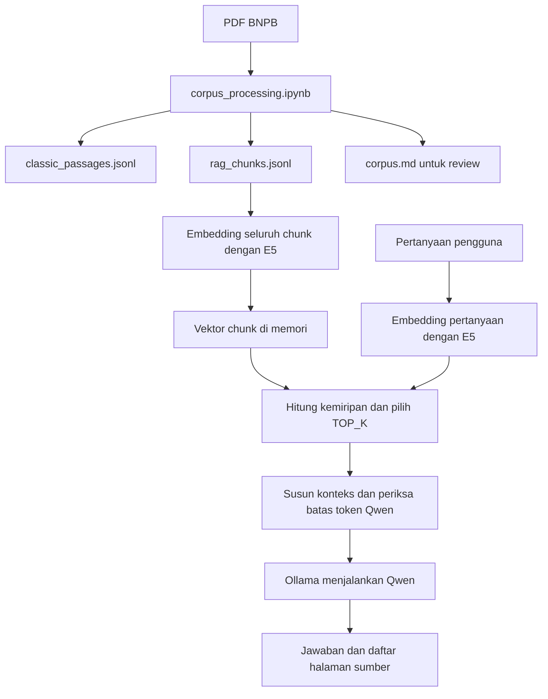

# Study Guide: Corpus Processing dan QA RAG Ollama

Panduan ini menjelaskan bagaimana PDF BNPB diolah menjadi korpus, lalu dipakai untuk menjawab pertanyaan. Penjelasan mengikuti urutan **setiap sel kode** pada dua notebook:

- [corpus_processing.ipynb](corpus/corpus_processing.ipynb)
- [qa_rag_ollama.ipynb](qa_rag_llm/qa_rag_ollama.ipynb)

Bagian C1–C10 membahas notebook corpus. Bagian Q1–Q10 membahas notebook QA. Nomor tersebut menghitung sel kode saja; sel Markdown tidak ikut dihitung. Nama fungsi dan ID sel disertakan agar bloknya mudah ditemukan.

Alur utama panduan ini memakai `corpus/output/` sebagai lokasi korpus yang dibaca QA. Nilai yang digunakan pada sel pengaturan QA adalah:

```python
CORPUS_PATH = os.path.join(ROOT, "corpus", "output", "rag_chunks.jsonl")
```

Daftar isi:

- [Arsitektur dan hubungan antarfile](#1-arsitektur-dua-tahap-yang-saling-terhubung)
- [Istilah dan sintaks dasar](#2-istilah-dan-sintaks-yang-perlu-dipahami)
- [Corpus processing: C1–C10](#3-notebook-corpus_processingipynb-blok-demi-blok)
- [QA RAG Ollama: Q1–Q10](#4-notebook-qa_rag_ollamaipynb-blok-demi-blok)
- [Penelusuran satu pertanyaan](#5-menelusuri-satu-pertanyaan-dari-awal-sampai-akhir)
- [Cara menjalankan dan latihan](#6-cara-menjalankan-dan-mempelajari-notebook)
- [Masalah umum](#7-masalah-umum-dan-blok-yang-perlu-diperiksa)

## 1. Arsitektur: dua tahap yang saling terhubung

Notebook pertama menyiapkan bahan pengetahuan. Notebook kedua mencari bagian bahan tersebut yang cocok dengan pertanyaan, lalu meminta LLM menyusun jawaban.



Ada tiga komponen dengan tugas berbeda:

| Komponen | Tugasnya |
| --- | --- |
| PyMuPDF | Membaca teks dan posisi teks pada PDF. |
| E5 multilingual-small | Mengubah teks menjadi vektor angka untuk pencarian. |
| Qwen melalui Ollama | Membuat jawaban berdasarkan konteks yang dikirim. |

**E5 mencari konteks; Qwen menyusun jawaban.** E5 tidak menghasilkan kalimat jawaban. Qwen tidak membaca seluruh PDF setiap kali ada pertanyaan.

### Tahap persiapan dan tahap menjawab

**Persiapan korpus:** jalankan notebook corpus saat sumber atau aturan ekstraksi berubah. Hasilnya disimpan sebagai file.

**Persiapan QA:** notebook QA membaca file chunk, memuat E5, lalu menghitung embedding seluruh chunk. Vektor disimpan dalam variabel `passage_vectors` selama sesi notebook berjalan.

**Menjawab pertanyaan:** cukup menghitung embedding pertanyaan, mencari chunk, dan memanggil Ollama. Embedding seluruh korpus tidak dihitung ulang untuk setiap pertanyaan.

Kode ini membandingkan pertanyaan dengan seluruh vektor menggunakan NumPy. Tidak ada layanan vector database, penyimpanan embedding permanen, proses training, atau fine-tuning dalam kedua notebook.

### File yang terlibat

```text
ta-nlp/
├── requirements.txt
├── STUDY_GUIDE.md
├── corpus/
│   ├── corpus_processing.ipynb
│   ├── knowledge_source/
│   │   └── Buku Saku Bencana BNPB.pdf
│   └── output/
│       ├── classic_passages.jsonl
│       ├── rag_chunks.jsonl
│       └── corpus.md
├── qa_rag_llm/
│   ├── qa_rag_ollama.ipynb
│   └── review_YYYYMMDD_HHMMSS.csv  ← dibuat saat evaluasi
└── evaluation/
    └── qa_pairs.jsonl            ← disiapkan untuk evaluasi
```

`classic_passages.jsonl` disiapkan untuk QA klasik dan tidak dibaca oleh notebook QA RAG. `corpus.md` membantu manusia memeriksa hasil ekstraksi. File yang dibaca QA RAG adalah `rag_chunks.jsonl`. Alur ini tidak memerlukan manifest JSON.

## 2. Istilah dan sintaks yang perlu dipahami

| Istilah | Penjelasan sederhana |
| --- | --- |
| Corpus atau korpus | Kumpulan teks yang menjadi sumber pengetahuan. |
| Unit atau passage | Satu bagian teks hasil ekstraksi yang dipertahankan sebagai satu kesatuan. Bisa lebih dari satu kalimat. |
| Chunk | Satu atau beberapa unit yang digabung untuk dipakai oleh RAG. |
| Metadata | Keterangan tentang teks, seperti halaman, topik, dan fase bencana. |
| Token | Potongan teks menurut tokenizer model. Satu kata bisa menjadi beberapa token. |
| Tokenizer | Alat yang mengubah teks menjadi ID token. Menghitung token belum berarti membuat embedding. |
| Embedding | Vektor angka yang dipakai model untuk mewakili teks dalam pencarian kemiripan. |
| Retrieval | Proses mencari chunk yang skornya paling sesuai dengan pertanyaan. |
| Prompt | Pesan berisi instruksi, konteks, dan pertanyaan yang diberikan kepada LLM. |
| Inference | Menjalankan model yang sudah tersedia tanpa melatih ulang bobotnya. |
| Hash | Sidik jari data untuk membedakan input atau hasil. Hash tidak mengukur kemiripan makna. |
| JSONL | Format satu objek JSON per baris. Setiap baris dapat dibaca terpisah. |

Contoh berikut hanya ilustrasi format JSONL, bukan kutipan dari buku:

```jsonl
{"id": "unit-1", "text": "Contoh teks pertama."}
{"id": "unit-2", "text": "Contoh teks kedua."}
```

Sintaks Python yang sering muncul:

| Sintaks | Kegunaan di notebook |
| --- | --- |
| `list` atau `[]` | Menyimpan data berurutan, misalnya daftar unit. |
| `dict` atau `{}` | Menyimpan pasangan nama dan nilai, misalnya `row["text"]`. |
| `set()` | Menyimpan nilai unik, misalnya nomor halaman hasil retrieval. |
| `Counter(...)` | Menghitung berapa kali nilai muncul. |
| `enumerate(data, 1)` | Melakukan loop sambil memberi nomor mulai dari satu. |
| `continue` | Melewati item sekarang dan melanjutkan loop. |
| `break` | Keluar dari loop yang sedang berjalan. |
| `with open(...)` | Membuka file dan menutupnya kembali setelah blok selesai. |
| `row.get("key", default)` | Membaca nilai; memakai `default` jika key tidak tersedia. |
| `.copy()` | Menyalin bagian luar list atau dictionary agar perubahan langsung tidak mengubah wadah aslinya. Isi yang bersarang tidak disalin secara mendalam. |
| `raise ValueError(...)` | Menghentikan proses karena nilai atau kondisi tidak sesuai. |
| `try/except` | Menangani error supaya program dapat memberi informasi atau melanjutkan pekerjaan. |

## 3. Notebook corpus_processing.ipynb: blok demi blok

Aliran variabel utamanya:

```text
pdf_bytes → specs per halaman → units → chunks → tiga file output
```

`specs` adalah hasil ekstraksi sementara. `units` sudah memiliki metadata lengkap. `chunks` adalah gabungan unit yang memenuhi aturan kelompok dan batas token.

### C1. Import, pengaturan, dan pemilihan PDF

**Lokasi:** sel kode ke-1, ID `corpus-02`.

**Tujuan:** memastikan file sumber yang benar sudah tersedia sebelum ekstraksi dimulai.

Library yang dipakai:

| Import | Peran |
| --- | --- |
| `Path` dari `pathlib` | Mengakses file dan folder pada versi notebook corpus saat ini. |
| `Counter` | Memeriksa jumlah kemunculan unit di dalam chunk. |
| `hashlib` | Membuat hash PDF, teks, ID chunk, dan versi korpus. |
| `json` | Membaca atau menulis data JSON. |
| `re` | Mencocokkan pola teks, misalnya spasi berlebih dan nomor daftar. |
| `unicodedata` | Menormalkan karakter Unicode. |
| `pymupdf` | Membuka PDF dan mengambil teks beserta koordinatnya. |
| `AutoTokenizer` | Memuat tokenizer E5 untuk menghitung panjang chunk. |

Notebook QA menggunakan `os.path` dan `open`; notebook corpus yang dijelaskan di sini masih menggunakan `pathlib`.

Pengaturan penting:

| Variabel | Arti |
| --- | --- |
| `PROJECT_DIR` | Folder kerja notebook saat dijalankan. |
| `KNOWLEDGE_DIR` | Folder PDF sumber. |
| `OUTPUT_DIR` | Folder tujuan tiga hasil korpus. |
| `PDF_FILENAME` | Nama PDF tertentu, atau `None` untuk memilih satu-satunya PDF yang tersedia. |
| `MAX_TOKENS = 350` | Batas token per chunk dengan aturan penghitungan E5. |
| `TOKENIZER_ID` | Nama tokenizer E5. |
| `TOKENIZER_REVISION` | Versi tokenizer yang digunakan agar pemrosesan lebih konsisten. |
| `EXPECTED_PDF_SHA256` | Hash PDF yang sesuai dengan aturan halaman dan koordinat. |
| `EXCLUDE_IDS` | Kumpulan ID unit yang ingin dikeluarkan setelah review. |

Urutan kerjanya:

1. Periksa folder `knowledge_source/`.
2. Kumpulkan file dengan akhiran `.pdf`.
3. Pilih PDF otomatis jika hanya ada satu, atau gunakan `PDF_FILENAME`.
4. Baca seluruh file ke `pdf_bytes`.
5. Hitung hash dan cocokkan dengan `EXPECTED_PDF_SHA256`.
6. Pastikan folder sumber dan output terpisah, bukan saling berada di dalamnya.

Hash diperiksa karena koordinat di blok berikutnya khusus untuk salinan buku tertentu. PDF dengan isi atau tata letak berbeda memerlukan pemeriksaan ulang aturan ekstraksi.

**Hasil blok:** `PDF_PATH`, `pdf_bytes`, dan `pdf_sha256` siap digunakan. Belum ada unit atau chunk yang dibuat.

### C2. Pemetaan halaman, topik, dan fase

**Lokasi:** sel kode ke-2, ID `corpus-04`.

**Tujuan:** memberi tahu program bagian buku yang perlu diambil dan metadata yang sesuai.

`SECTIONS` berisi rentang halaman. Contoh dari kode:

```python
(16, 19, "Gempa bumi", "GEMPA", "BENCANA_UTAMA")
```

Artinya, halaman PDF 16 sampai 19 termasuk bagian Gempa bumi, memiliki topik `GEMPA`, dan jenis materi `BENCANA_UTAMA`.

Aturan lainnya:

| Nama | Kegunaan |
| --- | --- |
| `DEFAULT_PHASE` | Fase awal suatu halaman. Halaman tanpa pengaturan memakai `UMUM`. |
| `PHASE_CHANGES` | Mengganti fase mulai dari koordinat vertikal tertentu. |
| `SKIP_EXACT` | Teks tertentu pada halaman tertentu yang dilewati saat ekstraksi biasa. |
| `HEADINGS` | Daftar judul yang dapat dikeluarkan dari isi teks. |
| `PLANT_CONTEXT` | Menambahkan nama tanaman sebagai konteks halaman vegetasi. |
| `HAZARDS` | Sembilan topik utama yang wajib tetap ada. |

Fase `PRA`, `SAAT`, dan `PASCA` berarti sebelum, saat, dan setelah bencana. `UMUM` dipakai untuk informasi yang tidak ditempatkan dalam ketiga fase tersebut.

Contoh `PHASE_CHANGES`: pada halaman PDF 19, fase awalnya `SAAT`, tetapi teks dengan posisi `y >= 227` mendapat fase `PASCA`.

Nomor halaman buku dihitung dengan `pdf_page - 2`, sesuai salinan sumber ini. Rumus tersebut bukan aturan umum untuk semua PDF.

**Hasil blok:** kumpulan aturan. PDF belum diekstrak pada sel ini.

### C3. Aturan koordinat untuk halaman khusus

**Lokasi:** sel kode ke-3, ID `corpus-06`. Variabel utama: `LAYOUT`.

**Tujuan:** membaca tabel, infografik, dan bagian dengan tata letak yang tidak aman dibaca sebagai paragraf biasa.

Di PDF, urutan objek teks bisa berbeda dari urutan visual. Misalnya, membaca tabel berdasarkan urutan objek dapat menggabungkan seluruh kolom pertama sebelum kolom kedua, sehingga pasangan label dan penjelasan menjadi salah.

`LAYOUT` memetakan nomor halaman ke daftar aturan ekstraksi. Isinya merupakan konfigurasi data, sehingga panjangnya tidak berarti ada algoritma berbeda pada setiap baris.

| Field | Arti |
| --- | --- |
| `parts` | Satu atau beberapa area yang digabung menjadi satu unit. |
| `rect` | Batas area dalam bentuk `[x0, y0, x1, y1]`. |
| `label` | Keterangan kolom atau bagian yang ditambahkan sebelum teks. |
| `phase` | Fase unit tersebut. |
| `subsection` | Nama subbagian yang lebih spesifik. |
| `context` | Keterangan tambahan, misalnya nama barang dalam tas siaga. |
| `quality_flags` | Penanda bagian yang perlu diperhatikan saat review. |
| `text_override` | Teks pengganti untuk koreksi transkripsi atau urutan baca. |
| `note` | Alasan koreksi, yang nantinya dapat menjadi `curation_note`. |

Koordinat menggunakan satuan koordinat halaman PDF, bukan nomor karakter. Pada halaman ini, nilai `x` bertambah ke kanan dan `y` bertambah ke bawah.

Sebagai ilustrasi, satu aturan bisa mengambil area kolom “Status” dan area kolom “Penjelasan”, lalu menghasilkan:

```text
Status: ...; Penjelasan: ...
```

`text_override` ditulis di notebook sebagai koreksi manual; kode tidak meminta model menebak perbaikannya. Area sumber tetap diperiksa keberadaan teksnya sebelum override digunakan.

**Hasil blok:** aturan ekstraksi khusus yang akan dipakai oleh `special_units()`.

### C4. Membersihkan teks dan mengekstrak area khusus

**Lokasi:** sel kode ke-4, ID `corpus-08`.

Blok ini mendefinisikan lima fungsi. Mendefinisikan fungsi belum menjalankan ekstraksi; fungsinya dipanggil pada blok C7.

**`clean(text)`** menormalkan karakter dengan NFKC, membuang soft hyphen yang tidak terlihat, mengganti rangkaian spasi atau baris baru menjadi satu spasi, lalu membersihkan spasi di ujung teks.

Ilustrasi:

```text
Input : "Teks   pertama\nbaris berikutnya"
Output: "Teks pertama baris berikutnya"
```

Fungsi ini tidak melakukan stemming, menghapus stopword, atau membuang angka dan negasi. Informasi dalam kalimat tetap diperlukan untuk jawaban.

**`phase_at(page_number, y)`** mengambil fase awal halaman, lalu memeriksa apakah posisi teks sudah melewati batas pergantian fase. Jika ada beberapa batas yang terlewati, fase mengikuti aturan terakhir yang berlaku.

**`word_left(word)`** mengambil koordinat kiri kata. Fungsi kecil ini digunakan sebagai kunci pengurutan kata dari kiri ke kanan.

**`region_text(words, rect)`** menyusun teks di dalam satu area:

1. Ambil koordinat dan identitas baris dari setiap kata.
2. Hitung titik tengah kata.
3. Masukkan kata jika titik tengahnya berada dalam `rect`.
4. Kelompokkan kata berdasarkan pasangan nomor blok dan nomor baris.
5. Urutkan kelompok baris berdasarkan posisi atas, lalu posisi kiri.
6. Urutkan kata dalam setiap baris dari kiri ke kanan.
7. Gabungkan kata, gabungkan baris, lalu panggil `clean()`.

`round(top, 1)` membulatkan posisi atas untuk pengurutan. `index` menjadi pembeda ketika posisi dua kelompok sama, sehingga Python tidak perlu membandingkan isi daftar kata sebagai penentu urutan.

**`special_units(page, page_number)`** menjalankan aturan `LAYOUT` untuk satu halaman. Setiap `part` dibaca melalui `region_text()`. Jika ada label, bagian digabung memakai `; `; jika tidak, dipakai spasi. Jika ada override, teks koreksi digunakan. Fungsi mengembalikan daftar spesifikasi yang sudah memiliki `text`.

**Hasil blok saat fungsi dipanggil:** daftar unit sementara dari halaman bertata letak khusus.

### C5. Mengekstrak halaman biasa

**Lokasi:** sel kode ke-5, ID `corpus-10`.

**Tujuan:** membaca halaman yang tidak memiliki aturan `LAYOUT`.

Struktur teks yang dibaca dari PDF:

```text
halaman → blok → baris → span
```

`span` adalah bagian teks dengan informasi tampilan, misalnya ukuran font. Satu baris bisa memiliki beberapa span.

`SKIP_TEXT` berisi judul atau slogan yang tidak dimasukkan sebagai isi. `line_position()` mengurutkan baris berdasarkan posisi atas dan kiri. `unit_position()` mengurutkan unit dengan cara serupa.

Alur `normal_units()`:

1. Ambil struktur teks halaman, dengan gambar dikeluarkan dari hasil ekstraksi.
2. Lewati blok yang bukan teks.
3. Urutkan baris dalam blok.
4. Gabungkan teks span pada setiap baris dan catat ukuran font terbesarnya.
5. Lewati baris kosong, bagian footer dengan `y >= 415`, teks dalam daftar skip, nomor daftar yang berdiri sendiri, serta judul tertentu dengan font lebih besar dari 10.
6. Tentukan fase lewat `phase_at()`.
7. Mulai unit baru jika belum ada unit dalam blok, fase berubah, atau baris memulai daftar bernomor/bullet yang cocok dengan pola regex.
8. Gabungkan bagian teks setiap unit, lalu urutkan semua unit.

Variabel `runs` menampung unit sementara dalam satu blok PDF. `runs[-1]` berarti unit terakhir, yaitu unit yang sedang menerima tambahan baris.

Setiap blok PDF mulai dengan `runs` yang baru. Karena itu, kalimat yang terpecah ke blok lain tidak otomatis selalu disatukan. Bagian bermasalah ditangani oleh aturan khusus.

**Hasil fungsi:** daftar unit sementara dengan `text`, `phase`, `x`, dan `y`. Blok ini membaca teks yang tersimpan di PDF; tidak ada proses OCR untuk mengenali tulisan dari gambar.

### C6. Memberi flag kualitas dan konteks pencarian

**Lokasi:** sel kode ke-6, ID `corpus-12`. Fungsi: `quality_flags()` dan `retrieval_text()`.

**`quality_flags(page_number, text, spec)`** menggabungkan flag dari aturan layout dengan flag berdasarkan halaman atau isi teks.

Contohnya, bagian COVID-19 diberi penanda panduan kesehatan historis dan sensitif terhadap waktu. Halaman aplikasi atau kontak diberi penanda catatan historis. Beberapa potongan dengan transkripsi atau klaim yang perlu ditinjau mendapat flag khusus.

| Contoh flag | Maksudnya untuk review |
| --- | --- |
| `TIME_SENSITIVE` | Informasinya dapat berubah seiring waktu. |
| `HISTORICAL_HEALTH_GUIDANCE` | Teks mengikuti panduan kesehatan pada sumber historis. |
| `HISTORICAL_RECORD` | Teks dicatat sebagai informasi dalam buku, misalnya kontak atau aplikasi. |
| `SOURCE_ATTRIBUTION_REQUIRED` | Pernyataan perlu dihubungkan dengan sumbernya. |
| `SOURCE_AMBIGUOUS` | Ada bagian sumber yang ambigu. |
| `DUBIOUS_SOURCE` | Ada klaim sumber yang perlu diperiksa. |
| `INCOMPLETE_SOURCE` | Bagian sumber tidak lengkap. |
| `NO_ABSOLUTE_PROTECTION_CLAIM` | Jangan menafsirkan materi sebagai jaminan perlindungan mutlak. |

`set` mencegah flag yang sama tersimpan berulang. Hasil akhirnya diurutkan agar urutan metadata konsisten.

**`retrieval_text(row)`** menambahkan konteks sebelum isi buku:

```text
section | subsection | context jika tersedia
text
```

Perbedaan dua field ini perlu diingat:

| Field | Isi dan penggunaan |
| --- | --- |
| `text` | Isi hasil ekstraksi atau koreksi transkripsi. Dikirim sebagai konteks ke Qwen. |
| `retrieval_text` | Isi teks ditambah label bagian dan konteks. Dipakai E5 untuk pencarian. |

Label membantu embedding memahami bagian yang sedang dibahas, walaupun teks aslinya pendek.

**Hasil saat fungsi dipanggil:** daftar flag dan teks untuk retrieval. Flag hanya metadata; notebook QA saat ini tidak otomatis menyaring atau mengubah jawaban berdasarkan flag tersebut.

### C7. Menjalankan ekstraksi seluruh halaman

**Lokasi:** sel kode ke-7, ID `corpus-13`.

**Tujuan:** menjalankan fungsi-fungsi sebelumnya dan membentuk `units` yang lengkap.

Alurnya:

1. Buka PDF dari `pdf_bytes` dan pastikan jumlahnya 98 halaman.
2. Loop halaman dengan nomor mulai dari satu.
3. Cari rentang `SECTIONS` yang mencakup halaman itu. Jika tidak ditemukan, lewati halaman.
4. Pilih `special_units()` jika halaman ada di `LAYOUT`; selain itu gunakan `normal_units()`.
5. Untuk setiap hasil ekstraksi, tentukan teks, fase, dan konteks.
6. Beri ID, metadata sumber, flag, serta status review.
7. Tambahkan `retrieval_text` dan masukkan ke `units`.

Ada aturan konteks tambahan untuk bagian di dalam bangunan, di dalam mobil, dan halaman vegetasi. Tujuannya menjaga keterangan yang membuat instruksi pendek tetap dapat dipahami.

Format ID unit:

```text
BNPB-<hash PDF pendek>-p<halaman>-u<urutan>-<hash teks pendek>
```

`p016` berarti halaman PDF 16. `u003` berarti unit ketiga pada halaman itu. Hash teks membantu membedakan unit ketika isinya berubah.

Isi satu unit:

| Field | Keterangan |
| --- | --- |
| `id` | Identitas unit. |
| `text`, `retrieval_text` | Isi teks dan versi yang memiliki label pencarian. |
| `topic`, `phase`, `material` | Topik, fase bencana, dan jenis materi. |
| `section`, `subsection`, `context` | Keterangan lokasi dan konteks isi buku. |
| `source.file` | Nama PDF sumber. |
| `source.pdf_page`, `source.book_page` | Nomor halaman PDF dan halaman tercetak. |
| `flags` | Penanda untuk review. |
| `review_status` | Diisi `pending_group_review`. |
| `curation_note` | Catatan koreksi, jika tersedia. |

Setelah semua unit terkumpul, kode memeriksa ID pada `EXCLUDE_IDS`. ID yang tidak dikenal menyebabkan error supaya salah ketik tidak terlewat. Unit yang dikecualikan kemudian dibuang, lalu kode memastikan semua sembilan topik utama masih terwakili.

**Hasil blok:** `units` berisi unit aktif. `topics` dan `pages` mencatat topik serta halaman unik yang terambil.

### C8. Menggabungkan unit menjadi chunk RAG

**Lokasi:** sel kode ke-8, ID `corpus-15`. Fungsi: `token_count()`, `group_key()`, dan `make_chunk()`.

**Tujuan:** membuat potongan konteks yang panjangnya terukur dan tidak mencampur bagian yang berbeda.

Tokenizer E5 dimuat dengan versi yang sudah ditentukan. Pada tahap corpus ini, hanya tokenizer yang digunakan; model embedding belum dimuat.

**`token_count(text)`** menghitung token dari:

```text
"passage: " + retrieval_text + special tokens tokenizer
```

`truncation=False` memastikan teks tidak dipotong untuk membuat hitungannya terlihat lebih kecil. Prefix `passage: ` belum disimpan di `retrieval_text`; prefix ditambahkan ketika menghitung token atau membuat embedding.

**`group_key(row)`** membuat tuple identitas kelompok:

```text
halaman PDF, topik, fase, subbagian, konteks, jenis materi, flag
```

Dua unit boleh digabung hanya jika seluruh nilai itu sama. Contohnya, instruksi sebelum bencana tidak digabung dengan instruksi setelah bencana.

**`make_chunk(items)`** menyalin metadata dari unit pertama, mengumpulkan `unit_ids`, menggabungkan teks dengan baris baru, membuat `retrieval_text`, menghitung token, dan membuat ID chunk dari hash daftar ID unit.

Loop penggabungannya memakai `current_units` sebagai kumpulan yang sedang dibangun:

1. Periksa apakah satu unit saja sudah melebihi `MAX_TOKENS`. Jika iya, hentikan proses.
2. Jika kelompok unit berikutnya berbeda, simpan chunk saat ini dan mulai kumpulan baru.
3. Jika kelompoknya sama, coba gabungkan unit baru dengan kumpulan saat ini.
4. Jika calon chunk terlalu panjang, simpan kumpulan lama terlebih dahulu.
5. Masukkan unit baru ke kumpulan aktif.
6. Setelah loop selesai, simpan kumpulan terakhir yang masih tersisa.

Ilustrasi dengan batas 350 token:

```text
Unit A dan B, kelompok sama, hasil gabungan 280 token → satu chunk
Tambah unit C, hasil gabungan 390 token              → chunk A+B ditutup
Unit C                                             → mulai chunk berikutnya
```

Angka di atas hanya ilustrasi. Kode menghitung ulang calon chunk dengan tokenizer; tidak sekadar menjumlahkan hitungan unit.

Penggabungan mengikuti urutan unit yang tersedia. Tidak ada pemotongan unit, overlap antar-chunk, atau pencarian kembali unit serupa yang jauh di belakang.

**Hasil blok:** `chunks`, masing-masing memiliki `unit_ids`, `text`, `retrieval_text`, dan `token_count`, beserta metadata sumbernya.

### C9. Memvalidasi hasil dan memberi versi korpus

**Lokasi:** sel kode ke-9, ID `corpus-17`.

**Tujuan:** memeriksa konsistensi hasil sebelum file ditulis.

Bagian pertama membuat dictionary `by_id`, sehingga unit bisa ditemukan langsung dari ID-nya. Sambil berjalan, kode memastikan ID unit unik, teks tidak kosong, fase valid, serta nomor halaman buku sesuai aturan sumber.

Bagian berikutnya memeriksa chunk:

- ID chunk tidak duplikat.
- Metadata kelompok setiap unit sesuai dengan chunk-nya.
- Teks chunk benar-benar sama dengan gabungan teks unit sumber.
- Hitungan token sesuai dengan hasil tokenizer.
- Panjang chunk tidak melebihi batas.

`represented = Counter()` menghitung berapa kali setiap unit masuk ke chunk. Semua unit aktif harus muncul **tepat sekali**. Nilai nol berarti unit hilang; nilai lebih dari satu berarti unit terulang.

Terakhir, kode membuat `corpus_version` dari hash data sumber, tokenizer, konfigurasi token, unit, dan chunk. Nilai versi yang sama ditambahkan ke semua unit dan chunk.

Versi membantu mengenali kumpulan hasil pemrosesan. Versi bukan penilaian kualitas, dan validasi struktur tidak membuktikan semua kalimat sudah benar secara isi. Karena itu, status review tetap `pending_group_review`.

**Hasil blok:** unit dan chunk yang sudah divalidasi serta memiliki `corpus_version`. Tidak ada manifest terpisah yang dibuat.

### C10. Menulis tiga output

**Lokasi:** sel kode ke-10, ID `corpus-19`.

**Tujuan:** menyimpan hasil agar dapat dibaca manusia dan dipakai notebook lain.

Pertama, kode menyusun `markdown_lines`. Ketika halaman berubah, judul halaman baru ditambahkan. Setiap unit ditampilkan bersama fase, flag, ID, konteks, dan catatan transkripsi jika ada.

Kedua, kode memeriksa folder output, membuatnya jika belum ada, lalu menulis:

| Output | Isi | Pemakai |
| --- | --- | --- |
| `classic_passages.jsonl` | Satu unit aktif per baris. | Sistem QA klasik atau pemeriksaan data. |
| `rag_chunks.jsonl` | Satu chunk per baris. | Notebook QA RAG. |
| `corpus.md` | Teks dan metadata dalam Markdown. | Reviewer manusia. |

`json.dumps()` mengubah dictionary Python menjadi string JSON. `ensure_ascii=False` menjaga karakter Unicode tetap mudah dibaca. `"\n"` memisahkan tiap objek JSONL ke baris sendiri.

Mode tulis `"w"` mengganti isi file hasil yang sudah ada. Ketiga file ditulis satu per satu setelah validasi selesai.

Pada hasil yang tersedia saat panduan ini disusun, `corpus/output/` berisi **455 unit dan 128 chunk**. Jumlah tersebut dapat berubah jika aturan, sumber, atau `EXCLUDE_IDS` berubah.

## 4. Notebook qa_rag_ollama.ipynb: blok demi blok

Aliran variabel utamanya:

```text
chunks → passage_texts → passage_vectors
pertanyaan → query vector → retrieved hits → selected context → jawaban
```

### Q1. Import, pengaturan, dan membaca JSONL

**Lokasi:** sel kode ke-1, ID `setup`.

**Tujuan:** menyiapkan konfigurasi dan memuat chunk hasil notebook corpus.

| Import | Peran |
| --- | --- |
| `os` | Menggabungkan path folder dengan `os.path.join()`. |
| `Counter`, `re`, `unicodedata` | Menghitung metrik jawaban setelah normalisasi teks. |
| `datetime`, `csv` | Memberi nama dan menulis file evaluasi. |
| `json` | Membaca JSONL dan menyiapkan data JSON. |
| `numpy` | Menyimpan vektor dan menghitung skor kemiripan. |
| `requests` | Mengirim permintaan HTTP ke Ollama. |
| `torch` | Menjalankan model embedding dan perhitungan tensor. |
| `AutoModel`, `AutoTokenizer` | Memuat model E5 dan tokenizer yang diperlukan. |

`ROOT = ".."` berarti satu folder di atas **folder kerja saat ini**. Karena itu, notebook dijalankan dari folder `qa_rag_llm/`. Path relatif tidak otomatis dihitung dari lokasi file notebook.

Konfigurasi utamanya:

| Variabel | Nilai dan fungsi |
| --- | --- |
| `CORPUS_PATH` | Mengarah ke `corpus/output/rag_chunks.jsonl` pada alur panduan ini. |
| `MODEL` | Model Ollama `qwen3:4b-instruct-2507-q4_K_M`. |
| `OLLAMA_URL` | Alamat layanan lokal `http://127.0.0.1:11434`. |
| `TOP_K = 4` | Ambil maksimal empat hasil pencarian. |
| `NUM_CTX = 4096` | Batas total token untuk prompt dan ruang jawaban. |
| `MAX_NEW_TOKENS = 384` | Maksimal token keluaran yang diminta dari Ollama. |
| `ABSTAIN` | Pesan fallback ketika tidak ada chunk yang dapat dipakai dalam konteks. |
| `QA_PATH` | Lokasi soal evaluasi. |
| `EVAL_SPLIT = "dev"` | Kelompok soal yang dievaluasi. |
| `RUN_EVALUATION = False` | Evaluasi tidak berjalan otomatis secara default. |

Pembacaan JSONL dilakukan dengan loop. Baris kosong dilewati. Setiap baris lain diubah menjadi dictionary melalui `json.loads()`, lalu dimasukkan ke list `chunks`.

**Hasil blok:** data chunk sudah berada di memori. Belum ada model atau embedding yang dibuat di sel ini.

### Q2. Memuat E5 dan tokenizer Qwen

**Lokasi:** sel kode ke-2, ID `embedding-models`.

**Tujuan:** menyiapkan alat pembuat embedding dan alat penghitung token prompt.

`AutoTokenizer.from_pretrained()` memuat aturan tokenisasi. `AutoModel.from_pretrained()` memuat model E5 beserta bobotnya. File yang belum tersedia di cache perlu diambil saat pemuatan.

```python
embed_model = embed_model.to("cpu")
embed_model.eval()
```

Baris pertama menempatkan model E5 di CPU. Baris kedua mengaktifkan mode evaluasi, termasuk menonaktifkan perilaku training seperti dropout.

Tokenizer Qwen dimuat terpisah karena penghitungan token E5 dan Qwen tidak harus sama. Di Python, kode hanya memuat **tokenizer Qwen**. Bobot model Qwen dijalankan oleh layanan Ollama saat dipanggil nanti.

**Hasil blok:** `embed_tokenizer`, `embed_model`, dan `qwen_tokenizer` siap digunakan.

### Q3. Membuat embedding teks dan seluruh korpus

**Lokasi:** sel kode ke-3, ID `embedding`. Fungsi: `embed(texts, prefix)`.

**Tujuan:** mengubah setiap teks menjadi satu vektor angka yang dapat dibandingkan.

`@torch.inference_mode()` membuat operasi di dalam fungsi berjalan tanpa pencatatan gradient untuk training. Ini berbeda dari `.eval()`: `.eval()` mengatur perilaku model, sedangkan inference mode mengatur pencatatan perhitungannya.

Fungsi menerima daftar teks dan prefix. Contoh pemakaian:

```python
embed(passage_texts, "passage: ")
embed([question], "query: ")
```

Urutan di dalam fungsi:

1. Ambil maksimal delapan teks menggunakan `texts[start:start + 8]`.
2. Tambahkan prefix ke setiap teks.
3. Tokenisasi batch dengan padding, truncation, dan `max_length=512`.
4. Jalankan E5 untuk memperoleh representasi setiap token.
5. Hitung rata-rata representasi token yang bukan padding.
6. Normalisasi setiap vektor.
7. Ubah hasil ke NumPy dan gabungkan semua batch.

`padding=True` membuat panjang item dalam satu batch sama. `attention_mask` bernilai satu pada token yang dihitung dan nol pada padding. `truncation=True` berarti input yang melewati batas 512 token dipotong oleh tokenizer; kode QA tidak menaikkan error untuk kondisi tersebut.

Bagian perhitungan inti:

```python
mask = inputs["attention_mask"].unsqueeze(-1)
token_sum = (hidden * mask).sum(dim=1)
token_count = mask.sum(dim=1)
pooled = token_sum / token_count
```

Misalkan `B` adalah jumlah teks dalam batch, `L` jumlah token setelah padding, dan `D` ukuran vektor model:

| Variabel | Bentuk | Makna |
| --- | --- | --- |
| `hidden` | `B × L × D` | Satu vektor untuk setiap token. |
| `mask` | `B × L × 1` | Penanda token yang ikut dihitung. |
| `pooled` | `B × D` | Satu vektor rata-rata untuk setiap teks. |

`unsqueeze(-1)` menambahkan dimensi agar mask dapat dikalikan ke seluruh komponen vektor token. `dim=1` berarti penjumlahan dilakukan sepanjang dimensi token.

`normalize(..., p=2, dim=1)` membuat panjang setiap vektor menjadi satu. Dengan vektor yang sudah dinormalisasi, dot product dapat dipakai sebagai skor cosine similarity.

Setelah definisi fungsi, loop mengambil `retrieval_text` dari seluruh chunk, lalu memanggil `embed()` dengan prefix `passage: `.

**Hasil blok:** `passage_vectors`, yaitu matriks `N × D` untuk `N` chunk. Baris ke-i sesuai dengan `chunks[i]`. Hubungan urutan ini harus tetap terjaga agar skor tidak dikaitkan ke teks yang salah.

### Q4. Mencari chunk terdekat dengan pertanyaan

**Lokasi:** sel kode ke-4, ID `retrieval`. Fungsi: `retrieve(question)`.

**Tujuan:** mengambil chunk yang memiliki skor kemiripan tertinggi dengan pertanyaan.

Alurnya:

1. Buat embedding pertanyaan dengan prefix `query: `.
2. Ambil vektor pertanyaan pertama karena input hanya berisi satu pertanyaan.
3. Jalankan `np.dot(passage_vectors, query)` untuk mendapatkan satu skor bagi setiap chunk.
4. Urutkan indeks dari skor terbesar ke terkecil.
5. Ambil maksimal `TOP_K` indeks pertama.
6. Salin dictionary chunk dan tambahkan field `score`.

```python
indexes = np.argsort(-similarity_scores, kind="stable")
```

`argsort()` mengembalikan indeks, bukan nilai skor. Tanda minus membuat pengurutan naik menghasilkan urutan skor asli dari besar ke kecil. `kind="stable"` mempertahankan urutan awal jika ada skor yang sama.

Contoh ilustrasi:

```text
Indeks chunk : 0     1     2
Skor         : 0.40  0.82  0.65
Urutan indeks: 1, 2, 0
```

`float(...)` mengubah tipe angka NumPy menjadi angka Python biasa. `.copy()` membuat penambahan `score` tidak menambah field itu ke dictionary chunk asli.

**Hasil fungsi:** list hasil pencarian, diurutkan dari skor tertinggi. Skor bukan persentase keyakinan atau bukti bahwa jawabannya tersedia. Kode tidak menggunakan ambang skor minimum, sehingga pertanyaan di luar korpus tetap dapat memperoleh hasil retrieval.

### Q5. Menyiapkan konteks dan memanggil Ollama

**Lokasi:** sel kode ke-5, ID `answer`. Fungsi: `answer(question)`.

Blok ini menghubungkan retrieval dengan pembuatan jawaban. Ada lima bagian di dalamnya.

**Bagian A — ambil hasil dan tentukan instruksi.**

`hits = retrieve(question)` memperoleh semua hasil top-k. `selected = hits.copy()` membuat daftar yang boleh diperkecil untuk menyesuaikan batas prompt. Teks `system` menginstruksikan Qwen untuk menjawab singkat dalam bahasa Indonesia, memakai konteks, dan memberi referensi.

**Bagian B — susun konteks dan pesan.**

Setiap chunk dalam `selected` diberi label:

```text
[S1 | PDF <nomor> | buku <nomor>] <text chunk pertama>

[S2 | PDF <nomor> | buku <nomor>] <text chunk kedua>
```

S1 berarti sumber pertama dalam konteks pertanyaan itu. Nomornya bukan ID permanen chunk; pada pertanyaan berikutnya, S1 bisa menunjuk chunk lain.

Kode lalu membuat dua `messages`: pesan `system` untuk instruksi dan pesan `user` yang berisi konteks serta pertanyaan. Konteks memakai `hit["text"]`; label tambahan dalam `retrieval_text` sebelumnya digunakan untuk embedding.

**Bagian C — periksa panjang prompt.**

Tokenizer Qwen menyusun format chat melalui `apply_chat_template()`, lalu menghitung jumlah tokennya. Syarat agar prompt dipakai adalah:

```text
jumlah token prompt + MAX_NEW_TOKENS <= NUM_CTX
```

Ruang jawaban ikut dihitung. Konteks tidak boleh menghabiskan seluruh kapasitas, karena model masih harus menghasilkan jawaban.

Jika terlalu panjang, `selected.pop()` menghapus chunk terakhir. Karena hasil sudah terurut, yang dikeluarkan adalah chunk dengan skor paling rendah di daftar tersebut. Loop kemudian menyusun dan menghitung prompt baru.

Ada dua kondisi khusus:

- Jika prompt tanpa chunk sudah muat, fungsi mengembalikan `ABSTAIN` tanpa memanggil Ollama.
- Jika prompt tanpa chunk masih terlalu panjang, fungsi menaikkan `ValueError` tentang batas konteks pertanyaan.

Perhitungan lokal ini menggunakan tokenizer dan template Qwen yang dimuat di Python. Yang dikirim ke Ollama nanti adalah daftar `messages`, bukan string `prompt` hasil perhitungan tersebut.

**Bagian D — kirim permintaan HTTP.**

`requests.post()` memanggil endpoint lokal `/api/chat` dengan model, pesan, dan opsi berikut:

| Opsi | Maksud |
| --- | --- |
| `stream=False` | Tunggu satu respons lengkap. |
| `num_ctx=NUM_CTX` | Atur kapasitas konteks pada permintaan. |
| `num_predict=MAX_NEW_TOKENS` | Batasi panjang keluaran. |
| `temperature=0` | Minta pemilihan keluaran dengan variasi sampling yang rendah. |
| `timeout=300` | Atur timeout request ke 300 detik. |

`raise_for_status()` membuat status HTTP yang gagal menjadi exception. Jika berhasil, teks diambil dari `response_data["message"]["content"]`. Jika terjadi exception dalam bagian request atau pembacaan respons, pesannya disimpan sebagai `error`.

**Bagian E — kembalikan hasil terstruktur.**

| Field hasil | Isi |
| --- | --- |
| `text` | Jawaban Qwen, pesan fallback, atau string kosong jika request gagal. |
| `hits` | Chunk yang masuk ke prompt setelah pembatasan konteks. |
| `retrieved` | Seluruh hasil pencarian top-k sebelum pembatasan konteks. |
| `error` | Pesan error request, atau string kosong. |

Misalnya, pencarian menemukan empat chunk tetapi hanya dua yang muat. `retrieved` tetap berisi empat chunk, sedangkan `hits` berisi dua. Perbedaan ini digunakan saat evaluasi.

**Batas perilaku yang perlu dipahami:** `ABSTAIN` adalah fallback program ketika konteks terpilih kosong. Untuk pertanyaan yang jawabannya tidak tersedia tetapi masih mendapat chunk, keputusan mengatakan “informasi tidak ditemukan” bergantung pada model dan instruksi prompt. Tidak ada pemeriksaan otomatis yang membuktikan setiap kalimat jawaban didukung sumber.

### Q6. Menampilkan jawaban dan menangani input chat

**Lokasi:** sel kode ke-6, ID `chat-functions`. Fungsi: `show_answer()` dan `chat()`.

**`show_answer(question)`** memanggil `answer()`, lalu menampilkan teks jawaban jika ada. Jika teks kosong, fungsi menampilkan pesan error. Setelah itu, fungsi menampilkan halaman sumber setiap chunk dalam `result["hits"]`.

Contoh format tampilan:

```text
(S1) PDF halaman 16 / buku halaman 14
```

Daftar tersebut menunjukkan sumber yang masuk ke konteks. Kode menampilkan semuanya, bukan hanya sumber yang benar-benar dikutip pada kalimat jawaban. Tidak ada pencocokan otomatis antara sitasi dalam jawaban dan daftar sumber.

**`chat()`** menjalankan loop input. `.strip()` membuang spasi di ujung pertanyaan. `.casefold()` membuat `/EXIT` dan `/exit` sama-sama dikenali sebagai perintah keluar. Input kosong tidak dikirim ke model.

Sel ini hanya mendefinisikan fungsi. Chat baru dimulai oleh blok berikutnya.

**Hasil saat fungsi dipanggil:** jawaban, error jika ada, dan halaman sumber tampil di output notebook. Riwayat percakapan tidak dimasukkan ke prompt pertanyaan berikutnya; setiap pertanyaan diproses secara mandiri.

### Q7. Menjalankan chat

**Lokasi:** sel kode ke-7, ID `chat`.

```python
chat()
```

**Tujuan:** memulai loop yang sudah didefinisikan di Q6.

Sel akan menunggu input berulang kali. Saat memakai Run all, proses tidak berlanjut ke sel di bawahnya sampai pengguna memasukkan `/exit`.

Memisahkan definisi fungsi dan pemanggilan membantu saat belajar: kamu dapat menjalankan ulang definisi tanpa langsung masuk ke sesi chat.

### Q8. Menormalkan jawaban dan menghitung EM/F1

**Lokasi:** sel kode ke-8, ID `scoring`. Fungsi: `tokens()` dan `scores()`.

**Tujuan:** membandingkan jawaban model dengan jawaban referensi untuk evaluasi.

`tokens(text)` menjalankan empat langkah:

1. Hapus label sumber dengan pola seperti `[S1]`.
2. Normalisasi Unicode dengan NFKC.
3. Ubah huruf menggunakan `.casefold()`.
4. Ambil rangkaian karakter kata melalui regex `\w+`.

Token dalam fungsi ini adalah hasil pemisahan regex untuk metrik, **berbeda dari token model E5 dan Qwen**. Angka dan underscore juga dapat masuk sebagai karakter kata pada pola ini.

Ilustrasi:

```text
"Gempa Bumi! [S1]" → ["gempa", "bumi"]
```

`scores(prediction, answers)` membandingkan prediksi dengan setiap jawaban dalam daftar `answers`.

**Exact match atau EM:** bernilai satu jika urutan token prediksi sama persis dengan salah satu referensi setelah normalisasi. Selain itu, nilainya nol.

**Token F1:** mengukur tumpang tindih token tanpa menuntut urutan yang sama. `Counter` mencatat frekuensi token. Untuk setiap token, overlap memakai nilai minimum antara frekuensi prediksi dan referensi, agar pengulangan tidak dihitung berlebihan.

Rumus yang dipakai kode:

```text
F1 = 2 × jumlah token overlap / (jumlah token prediksi + jumlah token referensi)
```

Contoh ilustrasi:

```text
Referensi : "gempa bumi"        → 2 token
Prediksi  : "gempa bumi terjadi" → 3 token
Overlap   : 2 token
EM        : 0
F1        : 2 × 2 / (3 + 2) = 0,8
```

Jika ada beberapa referensi, kode menyimpan nilai F1 terbesar dan EM terbaik. Jika kedua daftar token kosong, F1 untuk pasangan itu adalah satu. Jika daftar `answers` kosong, tidak ada pembandingan dan hasil tetap EM nol serta F1 nol.

**Detail implementasi saat ini:** regex menghapus `[S1]`, tetapi instruksi jawaban meminta format `(S1)`. Teks `(S1)` masih dapat menyumbangkan token `s1` pada penilaian. Jadi format sitasi dapat memengaruhi skor. Panduan ini menjelaskan perilaku kode yang ada; regex tidak diubah di sini.

**Hasil fungsi:** pasangan `(exact, best_f1)`. Metrik ini menghitung kecocokan teks, bukan menilai kebenaran makna secara menyeluruh. Dua jawaban yang maknanya mirip tetapi kata-katanya berbeda bisa mendapat skor rendah.

### Q9. Menjalankan evaluasi dan menulis CSV review

**Lokasi:** sel kode ke-9, ID `evaluation`. Fungsi: `evaluate()`.

**Tujuan:** menjalankan pertanyaan evaluasi satu per satu, mencatat jawaban, dan membuat hasil untuk penilaian manual.

**Bagian A — baca dan pilih soal.**

File `QA_PATH` dibaca per baris. Hanya soal dengan `row["split"] == EVAL_SPLIT` yang dimasukkan. Jika tidak ada soal yang cocok, fungsi berhenti dengan error.

Contoh satu baris file evaluasi:

```jsonl
{"id":"q001","question":"Apa yang dimaksud dengan gempa bumi?","answers":["Jawaban referensi yang sudah diperiksa."],"source_pdf_pages":[16],"answerable":true,"split":"dev"}
```

Kalimat referensi di atas adalah placeholder format; ganti dengan jawaban yang sudah dicocokkan dengan sumber. Untuk beberapa soal, tulis satu objek JSON pada setiap baris, bukan satu array JSON besar.

| Field soal | Kegunaan |
| --- | --- |
| `id` | Identitas soal; opsional, karena kode dapat memakai nomor urut. |
| `question` | Pertanyaan yang diberikan ke fungsi `answer()`. |
| `answers` | Daftar jawaban referensi yang diterima. |
| `source_pdf_pages` | Daftar halaman PDF yang mendukung jawaban. |
| `answerable` | Apakah soal dapat dijawab dari korpus. |
| `split` | Kelompok data, misalnya `dev` atau `test`. |

**Bagian B — jawab setiap soal.**

Kode memanggil `answer()` di dalam `try/except`. Jika terjadi error yang keluar dari fungsi itu, evaluasi membuat hasil kosong dengan pesan error dan tetap melanjutkan ke soal berikutnya.

**Bagian C — bedakan halaman referensi, retrieval, dan konteks.**

```text
gold_pages    = halaman yang seharusnya mendukung jawaban
found_pages   = halaman dalam seluruh hasil retrieval
context_pages = halaman dalam chunk yang benar-benar masuk ke prompt
```

Ketiganya memakai `set`, sehingga halaman yang ditemukan berkali-kali hanya dihitung sekali.

**Bagian D — hitung metrik.**

EM dan F1 dihitung hanya jika `answerable=True`. Untuk soal yang tidak dapat dijawab, kedua kolom diisi string kosong agar direview manual.

Page recall dihitung jika ada halaman referensi:

```text
page recall = jumlah halaman referensi yang ditemukan / jumlah halaman referensi
```

Contoh:

```text
gold_pages  = {16, 17}
found_pages = {16, 18, 19}
irisan      = {16}
page recall = 1 / 2 = 0,5
```

Recall memakai `retrieved`, sehingga mencerminkan hasil pencarian sebelum chunk dikeluarkan untuk batas token. Sebuah halaman bisa dihitung berhasil ditemukan meskipun chunk-nya kemudian tidak masuk ke prompt.

**Bagian E — simpan CSV dan ringkasan.**

Hasil ditulis ke `qa_rag_llm/review_YYYYMMDD_HHMMSS.csv`. `csv.DictWriter` memakai key dictionary sebagai nama kolom. `gold_answers` diserialisasi dengan `json.dumps()` agar daftar referensi mudah dibaca sebagai satu nilai kolom.

Kolom hasil memuat ID soal, pertanyaan, referensi, prediksi, halaman referensi, halaman retrieval, halaman konteks, EM, F1, recall, dan error. Kolom `correctness` serta `notes` sengaja kosong untuk reviewer manusia.

Ringkasan menampilkan jumlah seluruh soal, rata-rata EM, rata-rata F1, dan rata-rata page recall. **Ketiga rata-rata saat ini memakai soal answerable saja.** Jika tidak ada soal answerable, nilainya `None`.

Untuk implementasi sekarang, soal answerable perlu memiliki `source_pdf_pages` yang tidak kosong. Jika kosong, recall menjadi `""`, sementara agregasi mencoba menjumlahkannya sebagai angka dan dapat menghasilkan `TypeError`.

**Hasil fungsi:** file CSV review dan ringkasan di output notebook. Notebook tidak otomatis memberi nilai correctness untuk soal tanpa jawaban.

### Q10. Mengaktifkan evaluasi secara opsional

**Lokasi:** sel kode ke-10, ID `run-evaluation`.

```python
if RUN_EVALUATION:
    evaluate()
```

**Tujuan:** memberi pilihan apakah evaluasi ingin dijalankan.

Jika `RUN_EVALUATION=False`, pemanggilan dilewati. Jika nilainya `True`, fungsi evaluasi membaca file soal, memanggil model untuk setiap pertanyaan yang dipilih, dan membuat CSV.

Jika kamu mengubah nilainya pada sel setup lalu menjalankan ulang sel itu, `chunks` juga dimuat ulang. Pastikan embedding dibangun ulang sebelum menggunakannya jika isi atau urutan chunk berubah.

## 5. Menelusuri satu pertanyaan dari awal sampai akhir

Gunakan pertanyaan contoh: “Apa yang dimaksud dengan gempa bumi?” Penelusuran ini menjelaskan alur; urutan sumber sebenarnya ditentukan hasil embedding.

1. **Corpus C7:** halaman bagian Gempa bumi diekstrak, lalu unit diberi `topic`, `phase`, `source`, dan `retrieval_text`.
2. **Corpus C8–C10:** unit digabung menjadi chunk, divalidasi, lalu disimpan ke `rag_chunks.jsonl`.
3. **QA Q1:** chunk dibaca dari file ke list `chunks`.
4. **QA Q3:** seluruh `retrieval_text` diubah menjadi `passage_vectors`. Ini bagian persiapan sesi.
5. **QA Q4:** pertanyaan diberi prefix `query: `, dibuat embedding-nya, lalu dibandingkan dengan vektor chunk.
6. **QA Q5:** maksimal empat hasil teratas diberi label S1–S4. Daftarnya diperkecil jika prompt terlalu panjang.
7. **Ollama:** menerima pesan yang memuat instruksi, teks konteks, dan pertanyaan, lalu menjalankan Qwen.
8. **QA Q6:** jawaban ditampilkan bersama halaman chunk yang masuk ke konteks.
9. **Jika evaluasi aktif:** jawaban dibandingkan dengan referensi dan dicatat ke CSV.

Jika jawaban bermasalah, penelusuran dapat dimulai dari pertanyaan berikut:

```text
Apakah teks sumber terambil dengan benar?
    ↓
Apakah chunk yang benar masuk ke retrieved?
    ↓
Apakah chunk tersebut masih ada di hits setelah batas token?
    ↓
Apakah model memakai konteks itu dengan benar?
    ↓
Apakah metrik menilai format jawaban secara sesuai?
```

Setiap pertanyaan menunjuk tahap yang berbeda. Mengubah prompt tidak memperbaiki teks PDF yang salah diekstrak; meningkatkan `TOP_K` juga tidak otomatis memperbaiki cara metrik menormalisasi sitasi.

## 6. Cara menjalankan dan mempelajari notebook

### Urutan menjalankan

1. Gunakan environment dengan dependensi di `requirements.txt` root proyek.
2. Jalankan notebook corpus dari folder `corpus/` dengan PDF pada `knowledge_source/`.
3. Jalankan sel secara berurutan hingga tiga output terbentuk.
4. Periksa beberapa unit di `corpus.md` sambil melihat halaman PDF sumber.
5. Buka notebook QA dari folder `qa_rag_llm/` dan pastikan `CORPUS_PATH` menuju `corpus/output/rag_chunks.jsonl`.
6. Pastikan layanan Ollama berjalan dan model pada `MODEL` tersedia.
7. Jalankan setup, pemuatan model, embedding, dan definisi fungsi sebelum sel chat.
8. Ketik `/exit` ketika ingin berhenti chat.
9. Untuk evaluasi, siapkan file soal, atur split serta `RUN_EVALUATION`, lalu jalankan sel evaluasi.

Notebook menyimpan variabel dalam kernel. Mengedit fungsi atau pengaturan tidak langsung mengubah hasil yang sudah dihitung. Untuk memeriksa seluruh alur dengan keadaan yang bersih, restart kernel lalu jalankan semua sel sesuai urutan. Pemuatan model atau pembuatan embedding dapat memerlukan waktu.

### Latihan membaca variabel

Jalankan contoh berikut setelah blok yang sesuai sudah selesai. Sintaks contoh menggunakan loop biasa dan tidak menggunakan `pathlib`.

**Setelah C7: lihat satu unit.**

```python
unit = units[0]
print(unit["id"])
print(unit["text"])
print(unit["retrieval_text"])
print(unit["source"])
```

Perhatikan bagian mana yang berasal dari teks dan bagian mana yang merupakan label konteks.

**Setelah C8: telusuri isi satu chunk.**

```python
chunk = chunks[0]
print(chunk["token_count"])
print(chunk["unit_ids"])
print(chunk["text"])
```

Bandingkan `unit_ids` dengan unit asal. Chunk dapat berisi satu unit saja jika aturan kelompok atau batas token mencegah penggabungan.

**Setelah Q4: lihat hasil pencarian tanpa memanggil Ollama.**

```python
hits = retrieve("Apa yang dimaksud dengan gempa bumi?")
for hit in hits:
    print(hit["score"], hit["source"]["pdf_page"])
    print(hit["text"])
```

Latihan ini membantu memisahkan penilaian kualitas retrieval dari kualitas jawaban model.

**Setelah Q5: bandingkan hasil pencarian dan konteks.**

```python
result = answer("Apa yang dimaksud dengan gempa bumi?")
print("Ditemukan:", len(result["retrieved"]))
print("Masuk prompt:", len(result["hits"]))
print("Error:", result["error"])
```

### Pertanyaan untuk mengecek pemahaman

| Pertanyaan | Jawaban yang perlu kamu pahami |
| --- | --- |
| Mengapa corpus memakai tokenizer walaupun belum membuat embedding? | Untuk membatasi panjang chunk berdasarkan aturan token E5. |
| Mengapa `text` dan `retrieval_text` dipisah? | Label membantu pencarian, sementara isi teks dipertahankan untuk konteks jawaban. |
| Mengapa vektor pertanyaan memakai prefix berbeda? | Fungsi embedding mengikuti pemakaian E5 untuk query dan passage. |
| Mengapa `retrieved` bisa lebih panjang dari `hits`? | Beberapa hasil pencarian dapat dikeluarkan agar prompt muat. |
| Apakah top-k berisi empat hasil berarti pertanyaan pasti terjawab? | Tidak. Kode memilih skor tertinggi tanpa ambang relevansi. |
| Apakah skor F1 tinggi membuktikan semua klaim benar? | Tidak. F1 menghitung overlap token dengan referensi. |
| Apakah flag korpus otomatis diperhatikan Qwen? | Tidak. Kode QA tidak menerapkan aturan berdasarkan flag tersebut. |

## 7. Masalah umum dan blok yang perlu diperiksa

| Gejala | Periksa | Penjelasan |
| --- | --- | --- |
| PDF atau JSONL tidak ditemukan | C1 atau Q1 | Periksa folder kerja, nama file, dan path yang digunakan. |
| Hash PDF tidak cocok | C1 | Salinan PDF berbeda dari sumber aturan koordinat. |
| Region kosong | C3–C4 | Koordinat aturan tidak menemukan teks pada halaman sumber. |
| Teks tabel tertukar | C3–C4 | Periksa area kolom, label, dan urutan bagian pada `LAYOUT`. |
| Kalimat terpisah atau konteks hilang | C5–C7 | Periksa pembentukan unit, batas blok, dan metadata konteks. |
| Unit melebihi batas token | C8 | Satu unit sudah terlalu panjang; unit tidak dipotong otomatis. |
| Hasil retrieval tidak sesuai | Q3–Q4 | Periksa `retrieval_text`, input korpus, prefix, dan kesesuaian urutan chunk dengan vektornya. |
| Hasil retrieval benar tetapi konteks kurang | Q5 | Periksa chunk yang dikeluarkan saat penghitungan token Qwen. |
| Ollama tidak dapat dihubungi atau model tidak tersedia | Q5 | Lihat `result["error"]` dan konfigurasi layanan/model. |
| Run all berhenti menunggu | Q7 | Sel chat menunggu input sampai `/exit`. |
| Nilai EM/F1 turun karena sitasi | Q8 | Bandingkan format sitasi keluaran dengan pola yang dihapus oleh `tokens()`. |
| Tidak ada soal untuk split | Q9 | Periksa `EVAL_SPLIT` dan nilai `split` setiap soal. |
| Agregasi recall menghasilkan `TypeError` | Q9 | Periksa soal answerable yang memiliki halaman referensi kosong. |

Panduan ini membedakan tiga hal yang perlu diperiksa secara terpisah: ketepatan ekstraksi korpus, ketepatan pencarian konteks, dan ketepatan jawaban model. CSV serta halaman sumber membantu menelusuri tahap yang perlu diperbaiki.
